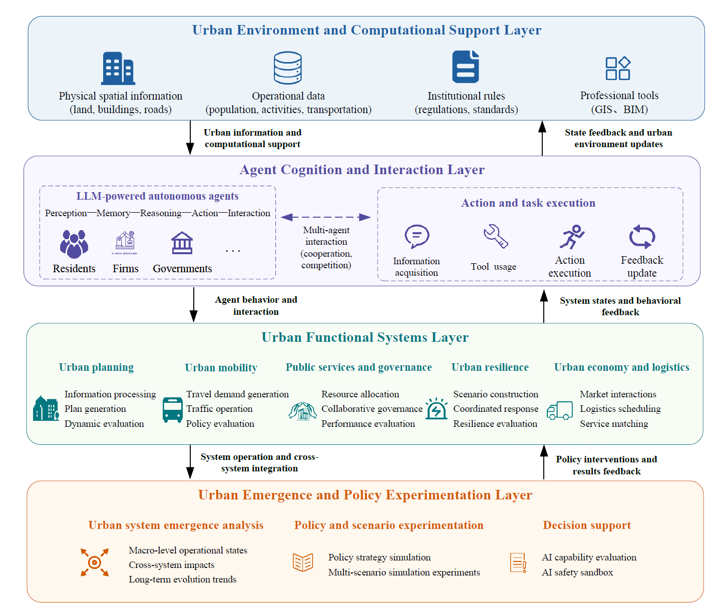

# WHAT IS REAL?

**An open research initiative for agent-based urban systems.**

Building toward interconnected urban simulations, starting with mobility.

[Current project](#current-project--agenticmobility)
· [Research directions](#research-directions)
· [Join the discussion](https://github.com/Agentic-City-Research/.github/discussions)

https://github.com/Agentic-City-Research/.github/issues/1

## About

AgenticCity explores how agents with distinct roles, information,
and memories interact through shared urban environments.
We develop research tools and reproducible simulations to study
how individual decisions and management policies shape urban outcomes.

## Current project · [AgenticMobility](https://github.com/Agentic-City-Research/Agentic-Mobility)

AgenticMobility connects LLM travelers and traffic managers
through a shared MATSim environment.

- Joint route and departure-time choice.
- Separate traveler and manager memories.
- Congestion pricing and traffic feedback.
- Traceable decisions, policies, and execution outcomes.

**Status:** Preparing for public release.

## Research directions

- **Behavior and memory:** How agents adapt through experience.
- **Policy and feedback:** How individual decisions and management
  interventions influence one another.
- **Interconnected urban systems:** How agents connect mobility
  with other urban activities and services.

Our current implementation focuses on mobility.
Connections to other urban systems are a 
longer-term research direction.

## Get involved

We welcome researchers and developers working on agents, transportation,
urban systems, and simulation. Contributions can include documentation,
reproducible examples, analysis tools, and new scenarios.

[Start a discussion](https://github.com/Agentic-City-Research/.github/discussions)
to share a research question, propose a collaboration, or discuss
a contribution.
